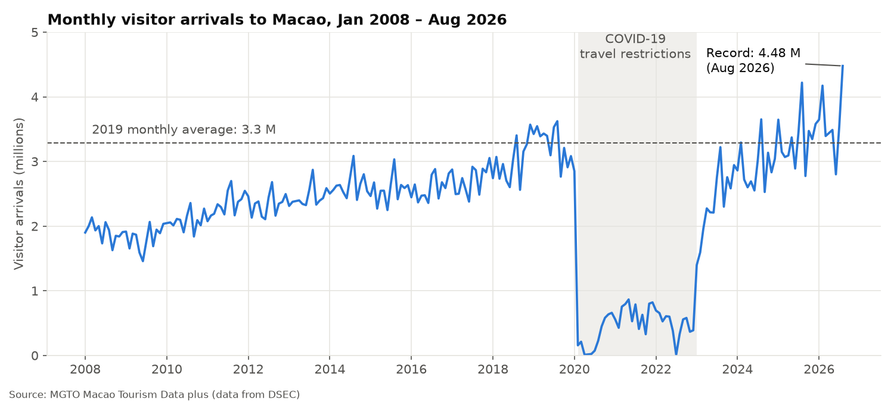
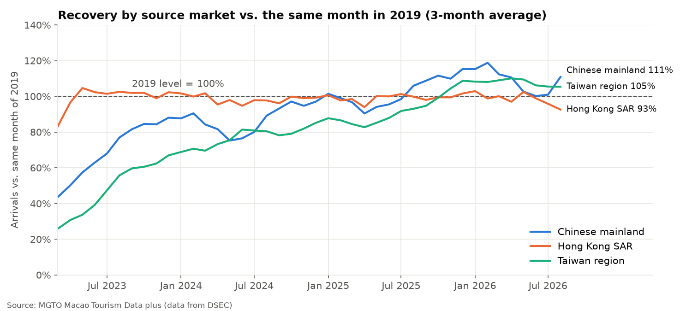

# Jenny Chen

## About me

I am a postgraduate student at the University of Macau, studying data science.
I enjoy turning public data into clear answers to everyday questions, especially
questions about the city I live in. This site collects my data analysis projects.

## Technical skills

| Area | Skills |
|---|---|
| Programming | Python |
| Data analysis | pandas (cleaning, reshaping, time-series resampling) |
| Visualisation | matplotlib |
| Tools | Git & GitHub, Jupyter, VS Code, Markdown |
| Methods | Data collection from web sources, data validation, descriptive statistics, year-over-year and seasonal comparisons |

## Project showcase

### Has Macao's Tourism Recovered? Visitor Arrivals 2008–2026

**Research question:** Have visitor arrivals to Macao returned to their pre-pandemic (2019)
level, and has the mix of source markets changed?

**Status:** Completed (data up to August 2026)

**Data:** Monthly visitor arrivals, January 2008 – August 2026, from the
[MGTO Macao Tourism Data plus](https://dataplus.macaotourism.gov.mo/) platform (data from DSEC).

**What the chart shows:** Arrivals grew steadily until 2019 (about 3.3 million per month), collapsed
during the COVID-19 travel restrictions in 2020–2022, and climbed back after the borders reopened in 2023.
In 2025 Macao received **40.07 million** visitors, **101.7%** of the 2019 total, and August 2026 set a
monthly record of **4.48 million**.

**Recovery by market:** Comparing each month with the same month in 2019 shows that Hong Kong visitors
returned almost immediately in 2023, mainland visitors passed the 2019 level in 2025, and visitors from
Taiwan were the slowest to recover. The overall mix is back to its pre-pandemic shape: the Chinese
mainland made up about 71% of arrivals in 2019 and 72% in 2025.

**Limitation:** The data counts trips, not unique people, so a repeat visitor is counted every time.

**Code and full write-up:**
[github.com/ChenJiayi-DS/data-science-project](https://github.com/ChenJiayi-DS/data-science-project)

---

<small>Data source: Macao Government Tourism Office (MGTO) / DSEC. Charts made by me with Python and matplotlib.
This is a non-commercial student project.</small>
